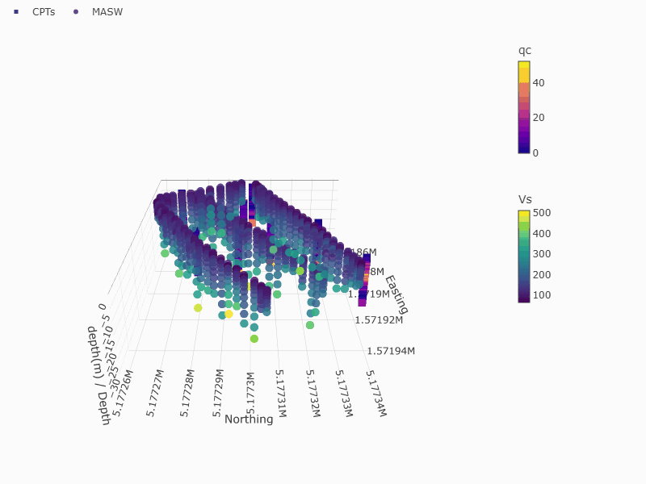

# 3D Site Investigation Data Visualizer

Interactive 3D visualization of CPT, MASW, and borehole data.



A local Python interface using Streamlit and Plotly. Source files are read, never modified or deleted. Multiple CSV datasets share a rotatable 3D coordinate grid. This plots measured points; it does not interpolate measurements into a volume.

## Start in the VisualizeData environment

In Anaconda Prompt (or a terminal where conda is initialized), create the environment only if it does not already exist:

```powershell
conda create -n VisualizeData python=3.11 -y
```

Then activate it, change to this application's folder, install the libraries, and start the interface:

```powershell
conda activate VisualizeData
cd "C:\Users\mdurmaz\OneDrive - Delft University of Technology\Surf_drive_yedek\Documents\Geophysical_Geotechnical\coding\CPT_MASW_Visualizer"
python -m pip install -r requirements.txt
python -m streamlit run app.py --server.address 127.0.0.1
```

Open the local URL printed in the terminal (normally http://localhost:8501). Keep the terminal running. Press Ctrl+C there to stop. Start it again with the last command; installations are needed only once. If conda is unavailable, install Miniconda first: https://docs.conda.io/en/latest/miniconda.html . Alternatively use `py -3.11 -m venv VisualizeData` and ` .\VisualizeData\Scripts\Activate.ps1` in this folder, then the same pip and streamlit commands.

## Use

1. Upload one or several CSV files. Each file has a preview, coordinate-column selectors, and a mapping table. Choose a CSV separator and decimal separator if needed. Files should be UTF-8 and have one header row.
2. Select X, Y, Z, and the measured variable from the actual headers. Choose the dataset name and variable label (for example `CPT qc (MPa)` or `MASW Vs (m/s)`). Upload the same file again to map another variable, or use a separate copy with a distinct filename.
3. For your MASW.csv, use X = Easting, Y = Northing, Z = Depth, Variable = Vs. Existing negative depths are preserved: leave the positive-depth-downward checkbox off. For positive depth, enable it. To align positive-depth and negative-depth datasets, convert them to a common Z convention before uploading. Depths measured from different ground levels require a common elevation datum for spatial comparison.
4. Every cloud defaults to a different marker shape (eight available; shapes repeat after eight). Adjust the shape if desired. Colors encode each dataset's variable and each has a separate color bar; equal colors across different variables do not mean equal physical values.
5. Sampling spacing is estimated from the median nearest-neighbour distance of unique 3D coordinates. For more than 20,000 unique points, queries use a deterministic subset against all locations. Coarser spacing produces larger markers: `size = base_size * sqrt(spacing / finest_visible_spacing)`, clipped to 2–24 pixels. Duplicate locations do not reduce the spacing. A single unique location uses the base size.
6. Nearest-neighbour spacing may be dominated by vertical sampling in CPT profiles. It does not measure physical survey resolution or horizontal line spacing. Select **Enter known spacing** to compare datasets using a chosen representative spacing/resolution, expressed consistently in coordinate units. The size is constant within each dataset; it represents that dataset's overall spacing. Marker size is in screen pixels, not a physical sphere diameter.
7. Rotate by dragging; scroll to zoom; use the Plotly toolbar to pan/reset. Click legend entries to toggle clouds. Set vertical exaggeration in the sidebar to make shallow profiles visible; the coordinate values themselves stay unchanged.
8. Invalid rows are excluded with a visible count. The ten existing #REF! rows in the supplied MASW.csv will be reported and excluded. Large datasets are deterministically sampled for display only, with a visible warning. Increase the point limit to display all points if your machine can handle them.
9. Download the interactive HTML for a portable plot, including its plotted data and Plotly library. It opens without Python or an internet connection. This export contains only displayed points if a display limit was applied.

All datasets must use compatible coordinate units, coordinate reference systems, depth signs, and vertical datums. The app does not automatically reproject or transform coordinates. Axis titles default to selected column names; override them with common labels/units where files differ.

## Colors, IDs, and soil types

- Choose **Numeric (continuous)** for Vs, qc, or other numerical measurements. **Value color scale** offers named palettes and optional custom low/high HEX colors. **Single dataset color** gives the entire dataset one chosen color, while hover still shows values.
- Choose **Categorical (soil type / discrete codes)** for Sand, Clay, Gravel, or numeric soil codes. Each unique category gets its own editable color picker with a HEX field and a legend entry. Numeric codes remain separate categories rather than becoming a continuous gradient. Blank categories and Excel error markers are excluded; literal `NA` text is preserved as a category.
- Select **CPT / borehole ID column** to include the ID on hover. Enable **Show one ID label per CPT / borehole** for permanent labels anchored at the shallowest positive depth (positive-depth-downward enabled) or highest elevation/negative depth (disabled). Labels use all valid rows before display sampling. Blank IDs do not remove otherwise valid measurements.
- IDs are read as text, so leading zeros such as `001` are retained. Each ID should identify one sounding within a dataset; repeated rows of that sounding share one label.
- To use the same soil color across several datasets, choose the same HEX code in their category color controls. Colors are configured separately for each dataset.

Restart the existing Streamlit command, or let Streamlit reload the edited files.

## Rotating GIF export

Install the updated dependencies in VisualizeData with `python -m pip install -r requirements.txt`. Kaleido needs Chrome or Chromium; if it cannot find one, run `plotly_get_chrome` in that environment to install Chrome.

Configure the datasets, then scroll to **Rotating GIF for GitHub**. Choose dimensions, frames and loop duration. Click **Generate rotating GIF**, wait for the progress bar, then click **Download rotating GIF**. A full 360-degree camera orbit uses your plot's current colors, category legends, IDs, axis labels and vertical exaggeration. It starts from a preset camera angle. Browser-only legend toggles and camera changes are not included; use dataset inclusion controls to choose what is exported. The GIF uses displayed points, including any display sampling.

Changing the plot or animation settings hides an outdated download until you regenerate it. GIFs use 256 colors, so continuous gradients may look less smooth than the interactive plot. Rendering can take several minutes; begin with 30 frames at 800 × 600. Many color bars, categories or ID labels may require a larger image or fewer visible datasets to avoid crowding.

Save the downloaded GIF as `assets/cpt_masw_demo.gif` in your repository and add this near the top of its README:

```markdown

```

## Source files

- `app.py`: interface and interactive plotting.
- `data_utils.py`: CSV reading, numeric validation, spacing, and marker scaling.
- `requirements.txt`: required libraries.

Official references: https://docs.streamlit.io/get-started/installation/command-line and https://plotly.com/python/3d-scatter-plots/ .
